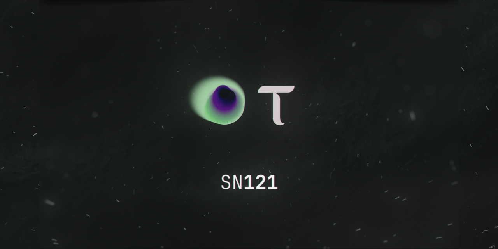

# SN121 — Competitive Skill-Challenge Mining on Bittensor

**Incentivizing the creation and benchmarking of commercial AI capabilities for business.**

This repository contains a complete guide to competing on Bittensor Subnet 121
(SN121), plus a working miner toolkit: a submission-ready skill bundle, a local
evaluation harness, and a research log from a live challenge.

- [How SN121 works](#how-sn121-works)
- [What miners submit](#what-miners-submit)
- [How submissions are scored](#how-submissions-are-scored)
- [Rewards and the leaderboard](#rewards-and-the-leaderboard)
- [What actually wins (field research)](#what-actually-wins-field-research)
- [This repository](#this-repository)
- [Running the local eval harness](#running-the-local-eval-harness)
- [Public API for reconnaissance](#public-api-for-reconnaissance)
- [FAQ](#faq)

---

## How SN121 works

SN121 is an incentivised AI development network owned by Sundae Bar AI PLC
(AIM: SBAR). Real business demand — customer requirements and market signals
identified through the sundae_bar platform — is translated into bounded
development **Challenges**. Developers (Bittensor miners) compete to build the
best AI capability for each Challenge; validators benchmark every submission
autonomously; the best skills can be integrated into sundae_bar's commercial
platform, where Scout composes them into agents for customers.

```
Business demand → SN121 Challenge → miners compete → best AI wins → deployed in sundae_bar
```

Challenges run **one at a time** as a rolling series (v17–v36 and counting —
sales ops, compliance, customer success, diligence, presentations). Each stays
open until a submission clears the qualifying bar (~0.80) plus a review window;
the date on the brief is a ceiling, not a promise. Between challenges, 100% of
miner emissions burn to UID 0 — that is intended, not a misconfiguration.

Two operating modes: pre-revenue (emissions subsidise development) and
commercial (a share of sundae_bar revenue is intended to fund ALPHA(121)
buybacks over time).

## What miners submit

A **skill bundle** — not code, not a model, a document that teaches a fixed
agent harness how to do the Challenge's job:

| Piece | Limits | Role |
|---|---|---|
| `SKILL.md` | ≤ 10,000 bytes, YAML frontmatter (`name`, `description`) | Always loaded. Holds the method: order of operations, decision rules, and when to read each reference. |
| `references/` | ≤ 30 files · ≤ 32,000 chars each · ≤ 128,000 total · `.md/.txt/.json/.yaml/.yml/.csv` · lowercase names | Read on demand via a `read_reference` tool — only when SKILL.md names them. Holds bulk content: worked examples, taxonomies, templates. |
| Single `SKILL.md` | under cap | Also a valid submission. |

The eval agent is a fixed harness with two tools: `load_skill` (returns SKILL.md
+ the reference file list) and `read_reference` (one file by name). Each
reference read costs the agent a step and counts against the scenario's token
budget (published per Challenge). A reference the agent never opens contributes
nothing.

Upload via the sundae_bar Lab (`sundaebar.ai/lab`). Rejected at upload: HTML
comments, images, scripts, hidden characters, nested archives, disallowed types,
anything over a limit. Text addressed to the evaluators or attempting to
override instructions scores zero.

**Submission limits:** a rolling daily cap plus **5 scored submissions per
hotkey per Challenge** — plan to iterate, not spray.

## How submissions are scored

Every Challenge ships a public suite bundle — `suite.yaml`, `dataset.jsonl`,
`rubric.txt` — downloadable for audit. The sealed half (reference outputs,
per-scenario criteria, judge notes) is revealed after close.

### Grader stack (from a live suite.yaml, v36)

| Grader | Weight | What it measures |
|---|---|---|
| `skill_use` | 30% | Did the agent actually follow the skill's procedure? Sub-criteria: novel knowledge, knowledge applied, situational judgment, output naturalness. **Not capped at .94**: v38 winner scored 1.0 on six scenarios; naturalness became the main separator. |
| `scenario_quality` | 30% | "N of 5 scenario criteria met" against the sealed reference output. **This is the real competition**: bottom ~0.57–0.65, mid ~0.70, top ~0.83–0.88. |
| `rubric` | 30% | Holistic LLM judge (temp 0) over 5 dimensions: contextual judgment, output quality, adaptability, domain knowledge, communication. Generous when substance is right. |
| `novelty_check` | 10% | Deterministic cross-scenario similarity. Boilerplate-identical outputs drop it toward 0; ~1.0 for everyone else. |

All judges ran `anthropic/claude-haiku-4.5` via OpenRouter in v36; models are
chosen per Challenge to match a realistic stack for the use case.

Final score: weighted mean per scenario → simple mean across ~10 scenarios.
Emissions follow the score, but the **pre-gates** run first.

### Pre-gates (pass/fail, opaque internals, zero the whole submission)

| Gate | Threshold | Catches |
|---|---|---|
| `skill_redundancy` | avg ≥ 0.5 | Content redundant with the base model's priors — generic restated procedure, padding, copied material. Teach knowledge a frontier model lacks. |
| `skill_alignment` | avg > 0.45 | Skill that doesn't match the task/rubric. |
| `dataset_derived` | avg > 0.45 | **Semantic** detection of scenario-derived patterns: dataset entity names, named registers from actual scenarios, examples mirroring scenario archetypes. Not a literal text match — verified zero n-gram overlap on failed subs. **Generalize every rule; invent all names in examples.** |

In v36, 4 of 196 submissions were zeroed — 3 by `dataset_derived`, 1 by
`skill_redundancy` — including an otherwise sophisticated skill from a past
challenge winner. Gates scan every file in the bundle, chunked, nothing
truncated.

## Rewards and the leaderboard

- **Winner-takes-all by time at #1.** The current leader receives **40%** of
  the scoring validator's weight; the remainder burns to UID 0. Paid per subnet
  epoch (~72 min) — the first epoch after a weight change still shows the
  previous recipient.
- **Leadership margin:** a challenger must beat the incumbent's *best* score
  (across any of their submissions) by **≥0.01**. Inside that it's a
  statistical tie and the incumbent keeps the lead. First scorer takes the lead
  with no margin.
- **The incumbent can run out of moves.** With 5 scored submissions per hotkey,
  a leader who has spent all 5 cannot respond to a takeover.
- Multi-hotkey accounts exist (one miner held 3 UIDs); similarity gates compare
  across the whole pool.
- Check live weights on the validator's
  [Taostats page](https://taostats.io/validators/5EL9y2gdesAcPiPmoyFKABToiui3RkXewiKxdTMmes34ZdNf/rewards)
  and the Lab's `/rewards` page for leadership windows.

## What actually wins (field research)

Full analysis in [`logs/playbook.md`](./logs/playbook.md) — the short version:

**Score decomposition.** `novelty_check` is ~free and the `rubric` judge is
generous. In earlier challenges the main margin was `scenario_quality`; v38
showed `skill_use` can also be decisive — the winner reached 1.0 on six
scenarios and beat our best mainly on output naturalness. Treat both sealed-call
coverage and natural, worked-example-driven style as first-order objectives.

**Bundle shape.** SKILL.md + **exactly one** reference file read in every
scenario beat everything else. Multi-file packs cap ~0.87 (more steps, more
tokens, diluted mimicry). Every top-10 SKILL.md used 9,900–10,000 bytes — spend
the whole budget.

**Content.** Bottom skills (0.66–0.72) wrote abstract "compliance-manual"
principles. Winners wrote **resolved rulings**: the dataset's scenarios probe
specific judgment calls, and each trap type needs an explicit verdict and
action pattern. The worked example is load-bearing — the harness mimics its
format and judgments more than the rules text, so put the load-bearing shape
(columns, count line, narrative structure) in the reference.

**Iteration economics.** Eval lag median ~2.5h (up to ~4.7h near close).
Submission #1 is reconnaissance: the results JSON shows exactly which scenarios
and criteria you lost. Iterate from that, not from local guesses.

## This repository

| Directory | Contents | Start here |
|---|---|---|
| `challenges/vNN-*/` | One competition per version; `suite/` has public test data, `accounts/` or `fleet/` holds bundle variants, and `BRIEF.md`, `RESULTS.md`, `POSTMORTEM.md` record the campaign | `challenges/v38-manager-coaching-and-1-on-1-preparation-skill/POSTMORTEM.md` |
| `logs/` | Research, session notes, strategy, and runbook (not submission files) | [`logs/INDEX.md`](./logs/INDEX.md) |
| `intel/` | Competitor and own-submission evidence, raw API dumps, past challenge corpus | [`intel/INDEX.md`](./intel/INDEX.md) |
| `manual-evals/` | Exported no-API prompts for Claude/ChatGPT manual generation/judging | `tools/export_eval_prompt.py` |
| `tools/` | Fetch, evaluation, packaging, similarity, and harvesting scripts | `tools/run_eval.py` |
| `templates/` | Reusable scout drafts and day-zero forms | `templates/DAY0-FORMS.md` |
| `drills/` | Historical practice scenarios and answer keys | `drills/v17-KEYS.txt` |
| `assets/` | Brand images and diagrams | |

Keep a submission bundle under `challenges/<version>/accounts/<account>/<variant>/`
with its `SKILL.md` and `references/` together. Raw API snapshots belong in
`intel/api-dumps/`, not at the repository root; harvested competitor files
belong in `intel/`, not `logs/`.

## Running the local eval harness

Requirements: Python 3.10+, an OpenRouter API key in `tools/.env`:

```
OPENROUTER_API_KEY=sk-or-...
MODEL=anthropic/claude-haiku-4.5        # optional; matches the real graders
BASE_URL=https://openrouter.ai/api/v1   # optional
```

```bash
# From the repo root; the harness finds suite/ in the challenge directory.
python tools/run_eval.py challenges/v37-investment-committee-memo-authoring-skill/accounts/dragon-uid141/v1-questions 0 2
python tools/run_eval.py challenges/v37-investment-committee-memo-authoring-skill/accounts/dragon-uid141/v1-questions 0 --grade
```

The harness simulates the base agent: it injects `SKILL.md` and **all files**
in `references/`, then answers each
`dataset.jsonl` scenario. `--grade` runs the public `rubric.txt` judge and
writes `*.grade.txt` with per-dimension scores and a rationale worth reading.
Production reads only the references the skill names, so local runs with
additional reference files can behave differently.

**Known blind spot:** local eval cannot measure `scenario_quality` — the
per-scenario criteria and reference outputs are sealed. Treat local rubric
scores as directional; the real iteration signal is the Lab's results JSON
after submitting.

## Public API for reconnaissance

`https://api.sundaebar.ai/api/v2` — no auth, but requires browser headers
(`Origin: https://www.sundaebar.ai`, `Referer: https://www.sundaebar.ai/`).

```bash
curl -H "Origin: https://www.sundaebar.ai" -H "Referer: https://www.sundaebar.ai/" \
  "https://api.sundaebar.ai/api/v2/challenges/latest"
```

| Endpoint | Use |
|---|---|
| `/challenges`, `/challenges/latest` | Live/past challenges, suite file URLs |
| `/submissions?challenge_id=<id>&limit=100` | Leaderboard + `leadership_margin`, `current_leader_best_score` |
| `/tasks?submission_id=<id>` | Per-scenario grader scores + feedback for any submission — the intel payload |
| `/submissions/limits` | Live bundle limits |
| `/rewards`, `/rewards/ledger` | Alpha totals, leadership windows |

Skill files are public on Supabase:
`…supabase.co/storage/v1/object/public/agent-submissions/<submission_id>/<path>`
— you can download the current leader's bundle and diff it against yours.

## FAQ

**Do I run a miner node?** No. You submit skill bundles through the Lab web
form; validators run the eval. Your cost is the SN121 registration burn per
hotkey.

**Why is 100% going to UID 0?** Between challenges all miner emissions burn —
normal. During a challenge, the #1 miner's UID holds 40% of validator weight.

**My submission scored 0. Why?** Open its results JSON — it names the gate and
why. Usual causes: dataset-specific content, rubric-mirroring text, padding,
or text addressed to evaluators.

**Can I confirm I'll beat the leader before submitting?** No — the deciding
grader uses sealed criteria, and the takeover bar (incumbent best + 0.01) sits
inside judge variance (±0.01–0.02/run). Submit, read the results JSON, iterate.
That's the designed loop.

**How do others write such similar skills?** Everything is public: the
dataset inputs, suite.yaml, rubric, every competitor's skill files on Supabase,
and per-scenario grader feedback via `/tasks`. The whole field iterates on the
same information — winning is a matter of coverage and worked-example fidelity.

## Further reading

- [How Rewards are Earned on SN121](https://www.sundaebar.ai/news/how-rewards-are-earned-sn121)
- [How sundae_bar Audits Every Score](https://www.sundaebar.ai/news/how-we-audit-scores)
- [How SN121 Scores a Skill](https://www.sundaebar.ai/news/how-sn121-scores-skills)
- [AI Evaluation Gaming: When the Rubric Becomes the Target](https://www.sundaebar.ai/news/when-the-rubric-becomes-the-target)
- [What Makes a Good AI Skill?](https://www.sundaebar.ai/news/what-makes-a-good-ai-skill)

---

*Real business demand drives what gets built. SN121 competes to build it.
sundae_bar puts the best AI to work.*
